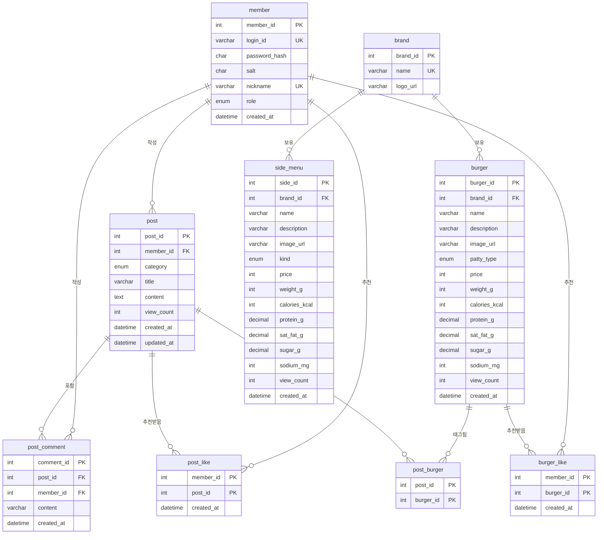

# OH Burger DB 설계

| 항목 | 내용 |
|---|---|
| 문서 버전 | v0.1 (2026-11-14) |
| DBMS | MySQL 8.0 이상 (티어 계산에 윈도 함수 사용) |
| 데이터베이스 | `oh_burger`, 문자셋 `utf8mb4` |
| 스키마 파일 | [db/schema.sql](../db/schema.sql) |

## 1. ERD



## 2. 테이블 요약

| 테이블 | 역할 | 관련 기능 |
|---|---|---|
| `member` | 회원 계정과 권한 | M-01, M-02 |
| `brand` | 브랜드 7곳 | B-01, T-02, R-01 |
| `burger` | 버거 기본 정보와 영양 정보 | B-01, B-02, T-01, R-01 |
| `side_menu` | 사이드 메뉴(사이드 · 치킨 · 디저트) 기본 정보와 영양 정보 | T-03 |
| `burger_like` | 버거 추천 (회원 × 버거) | B-03, 인기 티어 |
| `post` | 게시글 | P-01 ~ P-04 |
| `post_burger` | 게시글에 태그된 버거 (글 × 버거) | P-03, B-02, 인기 티어 |
| `post_like` | 게시글 추천 (회원 × 글) | P-05 |
| `post_comment` | 댓글 | C-01, C-02 |

## 3. 설계 결정

- **추천은 복합 기본키로 중복 방지**: `burger_like (member_id, burger_id)`, `post_like (member_id, post_id)`.
  같은 회원이 두 번 추천하는 것을 DB가 막아 준다. 토글은 행이 있으면 삭제, 없으면 삽입.
- **추천 수 · 댓글 수는 저장하지 않고 `COUNT` 로 계산**: 숫자가 어긋날 일이 없고, 데이터 규모가 작아 성능 부담이 없다.
- **조회수만 컬럼으로 저장**: 조회 이력을 행으로 남길 필요가 없어 `view_count` 를 1씩 올린다. 세션당 1회 제한은 서버 코드에서 처리.
- **영양 정보는 NULL 허용**: 브랜드가 공개하지 않은 항목은 NULL로 두고, 해당 티어표에서 제외한다.
- **티어는 저장하지 않음**: 조회할 때 SQL로 계산한다 (4번 참고).
- **분류 · 패티 · 권한은 ENUM**: 값이 고정돼 있어 별도 테이블을 두지 않는다. Java 쪽 enum과 1:1로 맞춘다.
- **사이드 메뉴는 `burger` 와 다른 테이블**: 같은 테이블에 넣으면 티어표 · 도감 · 룰렛 쿼리마다 버거만 고르는 조건을 붙여야 하고,
  하나라도 빠지면 감자튀김이 버거 순위에 섞인다. 열은 `burger` 와 같게 두고 패티 종류 자리에 종류(`kind`: 사이드 / 치킨 / 디저트)를 둔다.
- **삭제 규칙**
  - 게시글 삭제 → 댓글 · 추천 · 버거 태그 함께 삭제 (`ON DELETE CASCADE`)
  - 버거 삭제 → 추천 · 태그 함께 삭제. 태그됐던 게시글은 남는다
  - 회원 탈퇴 기능은 범위에 없으므로, 글 · 댓글이 있는 회원은 삭제할 수 없게 둔다
- **댓글 테이블 이름은 `post_comment`**: `comment` 는 MySQL 키워드라 피했다.
- **게시글당 버거 태그 최대 3개**: DB 제약으로 표현하기 번거로워 서버 코드에서 검사한다.

## 4. 티어 계산 쿼리

기능 명세서 4.3의 규칙을 SQL로 옮긴 것. `RANK()` 는 값이 같으면 같은 순위를 준다.

**단백질 티어** (열량 · 포화지방은 컬럼과 정렬 방향만 바꾼다. 낮을수록 좋은 지표는 `ASC`.
사이드 티어표(T-03)는 `burger` 자리에 `side_menu` 를 넣고, 종류를 골랐으면 안쪽 `FROM` 에 `WHERE kind = ?` 를 붙여 그 종류 안에서 순위를 매긴다.
가성비는 `protein_g` 자리에 `ROUND(protein_g * 1000 / NULLIF(price, 0), 1)` 을 넣고 `DESC` 로 정렬한다.
가격 · 단백질 중 하나라도 NULL 이면 식이 NULL 이 되어 `IS NOT NULL` 조건에서 빠진다)

```sql
SELECT burger_id, name, protein_g,
       CASE
         WHEN p < 0.10 THEN 'S'
         WHEN p < 0.30 THEN 'A'
         WHEN p < 0.70 THEN 'B'
         WHEN p < 0.90 THEN 'C'
         ELSE 'D'
       END AS tier
FROM (
  SELECT burger_id, name, protein_g,
         (RANK() OVER (ORDER BY protein_g DESC) - 1) / COUNT(*) OVER () AS p
  FROM burger
  WHERE protein_g IS NOT NULL
) ranked
ORDER BY p, name;
```

**인기 티어** (점수 = 추천 수×5 + 태그된 게시글 수×3 + 조회수×1, 점수 0은 제외)

```sql
WITH score AS (
  SELECT b.burger_id, b.name,
         (SELECT COUNT(*) FROM burger_like bl WHERE bl.burger_id = b.burger_id) * 5
       + (SELECT COUNT(*) FROM post_burger pb WHERE pb.burger_id = b.burger_id) * 3
       + b.view_count AS popularity
  FROM burger b
),
ranked AS (
  SELECT burger_id, name, popularity,
         (RANK() OVER (ORDER BY popularity DESC) - 1) / COUNT(*) OVER () AS p
  FROM score
  WHERE popularity > 0
)
SELECT burger_id, name, popularity,
       CASE
         WHEN p < 0.10 THEN 'S'
         WHEN p < 0.30 THEN 'A'
         WHEN p < 0.70 THEN 'B'
         WHEN p < 0.90 THEN 'C'
         ELSE 'D'
       END AS tier
FROM ranked
ORDER BY p, name;
```

## 5. 초기 데이터

- 브랜드 7곳은 `schema.sql` 에 포함
- 버거 데이터 160종은 [db/data_burger.sql](../db/data_burger.sql) (각 브랜드 공식 홈페이지에서 2026-11-14 조회, `schema.sql` 다음에 실행)
  - 가격은 롯데리아와 KFC(딜리버리 메뉴 기준)만 공식 사이트에 공개돼 있다. 맥도날드 · 버거킹 · 맘스터치 · 노브랜드버거는
    나무위키 · 기사에서 옮긴 매장 가격이라 최신 값과 다를 수 있다(출처는 `data_burger.sql` 주석). 확인하지 못한 53종은 NULL
  - 이미지 주소(`image_url`)는 브랜드 공식 사이트의 제품 사진 주소다. 파일은 저장하지 않고 화면에서 그 주소를 바로 불러온다
  - 패티 종류는 공식 분류가 아니라 메뉴명 · 설명을 보고 정한 값
- 사이드 메뉴 데이터는 [db/data_side.sql](../db/data_side.sql) (각 브랜드 공식 홈페이지에서 2026-11-21 조회, `schema.sql` 다음에 실행)
  - 넣는 것: 음료를 뺀 사이드 · 치킨 · 디저트, 노브랜드버거 샐러드
  - 빼는 것: 소스 · 시즈닝 · 잼 · 치킨무, 세트 · 박스 · 1+1 행사 · 버킷, 쉐이크 · 플로트, 맘스터치 피자 · 또잇(포장 간편식)
  - 사이즈 · 조각 수가 여러 개인 메뉴는 한 줄만 넣는다. 감자튀김은 기본 사이즈(M · R), 너겟 · 윙 · 텐더는 단독으로 살 수 있는 가장 작은 단위
  - 순살 · 뼈가 따로 있는 치킨은 한 줄로 합치고 영양 정보가 있는 쪽을 넣는다
  - 146종 (맥도날드 20, 버거킹 19, 롯데리아 28, 맘스터치 30, KFC 14, 노브랜드버거 19, 프랭크버거 16)
  - 가격은 75종에 있다. 롯데리아 · KFC 는 공식 값, 맥도날드 · 버거킹은 나무위키의 매장 가격, 맘스터치 · 노브랜드버거 · 프랭크버거는 NULL
  - 맘스터치 치킨처럼 표에 100g 당 값만 있는 메뉴는 총중량을 곱해 계산했고, 계산식을 `data_side.sql` 에 그대로 적어 두었다.
    열량 범위만 공개된 롯데리아 6종과 조각 무게를 모르는 KFC 치킨 1조각 4종은 열량이 NULL
  - 이미 만들어 둔 DB에는 `schema.sql` 전체를 다시 실행하지 말고 `CREATE TABLE side_menu` 부분만 실행한다 (전체를 실행하면 회원 · 글이 지워진다)
- 시연용 예시 데이터는 [db/data_demo.sql](../db/data_demo.sql) (가상의 회원 6명 · 게시글 12개 · 댓글 21개 · 추천, `data_burger.sql` 다음에 실행)
  - 데모 영상([데모시나리오.md](데모시나리오.md))과 화면 확인에 쓴다. 글에 적은 영양 정보 · 가격 · 티어는 DB 값과 맞춰 썼다
  - 다시 실행하면 시연용 계정과 그 계정이 쓴 글 · 댓글 · 추천만 지우고 다시 넣는다. 다른 회원의 데이터와 버거 조회수는 그대로다
  - 글 · 댓글의 작성자 외래키에 CASCADE 가 없어서 댓글 → 글 → 계정 순서로 지운다
  - 계정 아이디 · 비밀번호(관리자 계정 포함)는 파일 머리말에 있다
- 관리자 계정은 회원가입 후 `UPDATE member SET role = 'ADMIN' WHERE login_id = '...'` 로 지정
