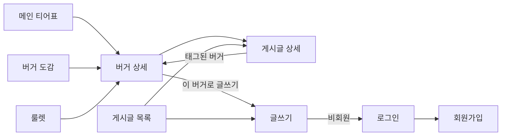

# OH Burger 화면 설계

| 항목 | 내용 |
|---|---|
| 문서 버전 | v0.1 (2026-11-14) |
| 프로토타입 | [docs/wireframe/](wireframe/) (HTML · CSS · JS, 서버 없이 동작) |

## 1. 프로토타입 보는 법

프로젝트 폴더에서 아래 명령을 실행한 뒤 브라우저에서 `http://localhost:5500` 을 연다.

```bash
python -m http.server 5500 --directory docs/wireframe
```

- 화면에 나오는 버거 수치와 게시글은 **화면 확인용 예시 값**이다. 실제 데이터는 DB에서 온다.
- 로그인 · 글 등록 · 댓글 등록 같은 서버 동작은 연결돼 있지 않다. 티어 계산, 검색 · 필터 · 정렬, 룰렛은 실제로 동작한다.

## 2. 화면 목록

| 화면 | 프로토타입 파일 | 실제 주소(안) | 관련 기능 |
|---|---|---|---|
| 메인 (티어표) | `index.html` | `/` | T-01, T-02 |
| 버거 도감 | `burgers.html` | `/burgers` | B-01 |
| 버거 상세 | `burger.html?id=` | `/burgers/detail?id=` | B-02, B-03 |
| 게시글 목록 | `posts.html` | `/posts` | P-01 |
| 게시글 상세 | `post.html?id=` | `/posts/detail?id=` | P-02, P-05, C-01, C-02 |
| 글쓰기 · 수정 | `write.html` | `/posts/write`, `/posts/edit?id=` | P-03, P-04 |
| 룰렛 | `roulette.html` | `/roulette` | R-01 |
| 로그인 | `login.html` | `/login` | M-02 |
| 회원가입 | `join.html` | `/join` | M-01 |

마이페이지와 관리자 버거 관리는 선택 기능이라 화면을 만들지 않았다.

## 3. 화면 흐름



모든 화면 위쪽의 공통 메뉴(티어표 · 버거 도감 · 게시판 · 룰렛)로 서로 이동할 수 있다.

## 4. 화면별 구성

**메인 (티어표)**
- 탭 4개(인기 · 단백질 · 열량 · 포화지방)로 기준 전환
- 브랜드 칩으로 표시할 브랜드 선택, 버튼으로 티어 줄 순서 뒤집기
- S ~ D 다섯 줄, 줄마다 버거 카드(이름 · 브랜드 · 기준 수치)

**버거 도감**
- 이름 검색, 패티 선택, 정렬 선택, 브랜드 칩(복수 선택)
- 카드 격자: 이름, 브랜드, 패티, 가격, 열량, 단백질, 추천 수

**버거 상세**
- 왼쪽 이미지, 오른쪽에 이름 · 가격 · 티어 배지 4개 · 영양 정보 표 · 추천 버튼
- 아래에 이 버거가 태그된 게시글 목록과 "이 버거로 글쓰기" 버튼
- 티어가 없으면 인기는 "집계 중", 영양 지표는 "정보 없음"으로 표시

**게시글 목록**
- 분류 탭(전체 · 꿀조합 · 꿀팁 · 자유), 검색, 정렬(최신순 · 추천순), 글쓰기 버튼
- 표: 분류, 제목(댓글 수 · 태그된 버거), 작성자, 작성일, 조회, 추천
- 아래 페이지 번호

**게시글 상세**
- 분류, 제목, 작성자 · 작성일 · 조회수, 태그된 버거(누르면 버거 상세), 본문, 추천 버튼
- 목록 · 수정 · 삭제 버튼 (수정 · 삭제는 권한이 있을 때만 표시)
- 댓글 목록과 입력란

**글쓰기 · 수정**
- 분류, 제목, 버거 태그(이름 검색 후 선택, 최대 3개, 칩으로 표시하고 누르면 제거), 내용
- 버거 상세에서 넘어오면 그 버거가 미리 태그됨

**룰렛**
- 왼쪽 조건: 브랜드, 패티, 가격 상한, 열량 상한, 조건에 맞는 버거 수
- 오른쪽 룰렛 판과 결과 카드(상세 보기 버튼)
- 후보가 12개를 넘으면 12개만 무작위로 올림

**로그인 · 회원가입**
- 가운데 정렬된 좁은 입력 카드, 입력 조건 안내, 오류 문구 자리

## 5. 디자인 기준

실제 구현의 디자인은 "참깨 번"이다 (`src/main/webapp/css/style.css`). 프로토타입(`docs/wireframe/`)은 처음의 크림색 · 주황 디자인 그대로 남아 있다.

색은 버거 재료에서 가져왔다. 번(빵) 갈색을 주색으로 쓰고, 토마토 빨강은 누르는 버튼에만 써서 화면이 튀지 않게 했다.

| 항목 | 값 |
|---|---|
| 배경 / 카드 | 밝은 크림색 `#fffbf4` / 흰색. 카드는 테두리 없이 옅은 그림자로 구분 |
| 주색 | 번 갈색 `#a9621a` (로고, 선택된 메뉴 · 칩 · 쪽 번호) |
| 버튼 강조색 | 토마토 빨강 `#d43a2f` (등록 · 검색 · 가입 같은 주요 버튼에만) |
| 글자 | 짙은 갈색 `#2c1d12`, 흐린 글자 `#8a7867` |
| 헤더 | 흰 바탕. 맨 위에 재료 색 줄무늬 띠(번 · 상추 · 치즈 · 패티 · 번) |
| 티어 색 | S 토마토 `#d43a2f`, A 구운 번 `#e0842a`, B 치즈 `#d9a400`, C 상추 `#5f9a2f`, D 패티 `#7a5a44`. 티어표의 줄 머리는 옅은 바탕에 색 글자, 상세의 작은 표시는 색을 채움 |
| 모양 | 버튼 · 칩 · 탭은 알약 모양, 카드 모서리 16px |
| 글꼴 | Pretendard (인터넷에서 불러옴. 연결이 없으면 맑은 고딕으로 보임) |
| 폭 | 최대 1120px, 760px 이하에서는 한 단으로 배치 |
| 버거 이미지 | 이미지가 없는 동안 재료 색 줄무늬로 그린 버거 표시(`.thumb`)를 보여 준다. 그림 문자는 쓰지 않는다 |

## 6. 실제 구현으로 옮길 때

- `css/style.css` 는 그대로 가져다 쓴다.
- `js/common.js` 의 `layout()` 은 JSP include(헤더 · 푸터)로, 예시 데이터 배열은 DB 조회로 바꾼다.
- 티어 계산은 프로토타입에서는 JS로 했지만 실제로는 SQL로 한다 ([DB설계.md](DB설계.md) 4번).
- 룰렛 화면의 회전 · 당첨 로직은 그대로 쓰고, 후보 목록만 서버 응답으로 바꾼다.
